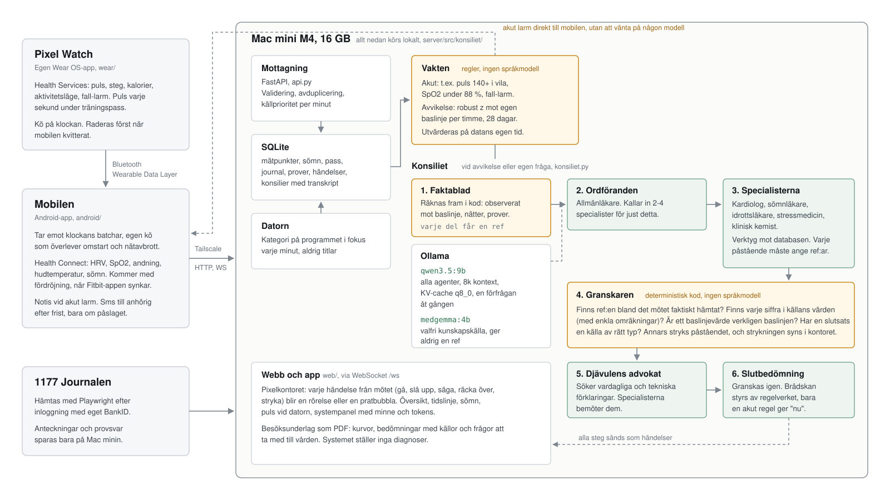

# Kropp64

**Sensorpanelen för din viktigaste rigg: dig själv.**

Som AIDA64 och HWiNFO64, fast för kroppen, och med ett lokalt läkarteam av AI-agenter som läser sensorerna.
Allt körs på en Mac mini M4 med 16 GB. Ingen hälsodata skickas till någon molntjänst.

Pixel Watch, mobilen och Mac minin samlar puls, HRV, syremättnad, andning, hudtemperatur, sömn och steg. Mac minin
loggar dessutom vilken sorts program jag har i fokus, så att jag kan se klockfrekvensen under ett kodpass eller en
spelkväll bredvid vilopulsen. När något avviker från min egen baslinje startar en tråd: ett läkarteam av lokala
agenter svarar, varje påstående måste peka på en mätpunkt, en journalrad eller ett provsvar, och en moderator i
ren kod stryker allt som inte går att belägga. Det som blir kvar är ett underlag med frågor att ta med till
vården, aldrig en diagnos.

I webben syns tråden som ett pixelkontor där läkarna går till arkivet, slår upp kurvor och svarar varandra.



## Status

Läget den 24 november 2026:

- Hela kedjan klocka, mobil, server, vakt och läkarteam fungerar och är testad på emulatorer och syntetisk
  testdata (se [RESAN.md](RESAN.md)). Den har ännu inte gått länge på min riktiga klocka, så det finns inga
  resultat från riktig data att visa än.
- Läkarteamet utvärderas mot 16 tränade scenarier och 16 holdout-scenarier med syntetisk data och facit
  ([eval/RESULTAT.md](eval/RESULTAT.md)). På holdout-scenarierna (skrivna innan de kördes) gick godtagbar brådska
  från 56 % (gamla pipelinen, 3 övertriage och 4 undertriage) till 100 % (v8), täckningen av måste-fynd från 67 %
  till 94 % och mediantiden från 226 till 118 sekunder. Brådskan styrs av ett öppet regelverk med teamet som får
  höja men inte sänka; utan regelverket (bara faktabladet) var det 73 % med 4 undertriage. Allt är syntetiskt,
  och metoden och förbehållen står i eval/RESULTAT.md. v8 är omkörd med oförändrad kod och modell: rätt brådska
  i 36 av 36 holdout-trådar och godtagbar i 64 av 64 tränade, täckning 91-94 % mellan körningarna.
- Alla skärmbilder och filmer i repot är märkta som demo, syntetisk testdata eller emulator.

## Sensorpanelen

Översikten är byggd som en hårdvarumonitor: en tät tabell med Aktuellt, Min, Max och Medel per sensor, grupperat
som hårdvara.

| Grupp | Sensorer |
|---|---|
| Hjärta (Pixel Watch) | Klockfrekvens (puls, BPM), Idle-klock (vilopuls, BPM), Timingmarginal (HRV, ms) |
| Andning | Andningsfrekvens (/min), SpO2 (%) |
| Kylning | Hudtemperatur (°C), Headroom (återhämtning, av 100) |
| Last | Steg, Stresstest (minuter med puls över 100), Uptime vid datorn (min) |

Skämten står i rubrikerna, enheterna står alltid bredvid siffrorna. Under tabellen finns tidslinjen med
datortiden som band (kod, spel, chatt, webb), sömnen, nätterna, Headroom med öppen formel och POST-skärmen,
morgonbriefen som idrottsläkaren skriver utifrån nattens siffror.

**Uptime vid datorn** är den del jag själv tittar mest på: minuter per programkategori och medianpulsen under just
de minuterna. Bara kategorin sparas, aldrig fönstertitlar eller innehåll.

## Varför lokalt

Puls dygnet runt, sömn, journalanteckningar och provsvar från 1177 är bland det känsligaste som finns om en
människa. Jag vill inte skicka det till en molnmodell för att få en sammanfattning. En Mac mini med 16 GB räcker
för en 9B-modell om man är snål med minnet, och det är just begränsningen som gjort bygget intressant: allt i
läkarteamet är format efter att en modell som läser prompten i ungefär 75 tokens/s och skriver i 17 tokens/s ska
hinna klart innan nästa larm.

Molnet (Claude Code) användes bara för att bygga koden, mot testdatabaser med syntetisk data.

## Varför agenter, och var det inte är agenter

Ett larm om hög nattpuls kan förklaras av ett träningspass, kort sömn, en infektion på väg, en klocka som sitter
löst eller något som faktiskt behöver undersökas. Att väga sådant mot varandra passar ett team där var och en
slår upp sin del och någon annan försöker motbevisa.

Men det som måste vara rätt varje gång är inte en språkmodell:

- **Vakten** är regler och statistik. Akuta larm (t.ex. puls över 140 i vila, SpO2 under 88 %, klockans
  fall-larm) går till mobilen på millisekunder utan att vänta på någon modell. Bara de reglerna kan leda till
  sms till en anhörig.
- **Faktabladet** räknas fram i kod innan tråden startar: observerat mot baslinje, nätter, prover, med en
  referens per del.
- **Moderatorn** (granskaren) är deterministisk kod. Ingen modell kan prata sig förbi den.
- **Brådskan** styrs av regelverket. Teamet kan justera inom en ram men aldrig ge "kontakta vården nu" om inte
  en akut vaktregel slagit till.

## En tråd, steg för steg

Koden finns i [server/src/konsiliet/konsiliet.py](server/src/konsiliet/konsiliet.py) (internt heter tråden
fortfarande konsilium).

1. **Utlösare.** Vakten hittar en avvikelse (robust z-poäng mot min egen baslinje för samma timme på dygnet,
   28 dagar bakåt, med puls bara från vilominuter), eller så startar jag en tråd med en fråga.
2. **Faktablad.** Räknas fram deterministiskt. Varje del får en referens (`F:puls`, `F:natter`, `F:prover` ...),
   och verktygsuppslag ger egna: `S:hr:<start>-<slut>` (serie), `B:` (baslinje), `J:` (journal), `L:` (provsvar),
   `N:` (natt).
3. **Trådstartaren** (allmänläkare) läser utlösaren och faktabladet och kallar in 2-4 av kardiolog, sömnläkare,
   idrottsläkare, stressläkare och Labbet (klinisk kemist).
4. **Specialisterna** svarar i tråden med strukturerad JSON (Ollama `format` med JSON-schema). Varje påstående
   har en lista med källor, och schemat låser källorna till referenser som faktiskt finns i tråden. De kan slå
   upp mer med verktyg: `hamta_serie`, `jamfor_baslinje`, `hamta_somn`, `sok_journal`, `hamta_labb`.
5. **Moderatorn** prövar varje påstående (se nedan). Det som stryks syns som "Strukit av moderator" i kontoret.
6. **Trollet** (djävulens advokat) letar vardagliga och tekniska förklaringar, med källor: "har du testat att
   dra åt armbandet?". Specialisterna bemöter dem.
7. **Trådstartaren** skriver lösningen. Den granskas igen, mening för mening, och brådskan sätts av regelverket.
   I gränssnittet visas den som "Markerad som lösning".
8. Allt sparas med transkript, bevis och tokenåtgång. Varje steg sänds som en händelse på en buss, och det är
   de händelserna som styr figurerna i kontoret.

### Moderatorn

`kontrollera()` i konsiliet.py stryker ett påstående om något av detta gäller:

- det saknar källa, eller källan finns inte bland det tråden faktiskt hämtat
- en siffra i texten finns inte bland källans värden. Siffror med enhet jämförs mot rätt sorts värden (puls
  mot puls, procent SpO2 mot SpO2). Avrundning och enkla omräkningar som minuter till timmar godkänns. Klockslag,
  datum och perioder räknas inte som mätvärden.
- ett tal kallas baslinje men är inget baslinjevärde i källan
- en slutsats (t.ex. om rytm, infektion eller syresättning) saknar källa av rätt typ

Ett verkligt exempel från bygget: en specialist skrev att baslinjen var 73,2 när källan sa 72,5. Moderatorn
strök det. Den var också för sträng i början och strök klockslag och omräkningar som 450 min = 7,5 h. Båda
fallen finns nu som enhetstester i [server/tests/test_granskare.py](server/tests/test_granskare.py).

Moderatorn kontrollerar att det som sägs finns i datan. Den kan inte avgöra om en medicinsk tolkning är klok.
Det är därför slutsatser kräver källa av rätt typ och brådskan inte bestäms av modellen.

## Uppmätt

Bara siffror som finns i en fil i repot.

| Vad | Värde | Källa |
|---|---|---|
| qwen3.5:9b, generering | 17,4 tokens/s | [bench/resultat/qwen3.5_9b.json](bench/resultat/qwen3.5_9b.json) |
| qwen3.5:9b, promptläsning | 75,4 tokens/s | samma |
| qwen3.5:9b, laddningstid / minne i benchen | 20,5 s / 7,21 GB | samma |
| Rätt verktyg valt på 10 testfrågor | 9 av 10 (rätt argument 8 av 10), median 1,38 s | samma |
| Första riktiga tråden | 278 s, ingen bedömning, 47 656 prompttokens | [RESAN.md](RESAN.md) |
| Minne för modellen med 16k kontext och parallella förfrågningar | 14,7 GB av 16, datorn swappade | RESAN.md |
| Efter 8k kontext, en förfrågan åt gången, KV-cache q8_0, flash attention | 9,1 GB, en tråd 250 s i stället för 563 s | RESAN.md |
| Utvärdering, 16 holdout-scenarier, gamla pipelinen | godtagbar brådska 56 %, täckning 67 %, median 226 s | [eval/RESULTAT.md](eval/RESULTAT.md) |
| Utvärdering, 16 holdout-scenarier, nuvarande (v8) | godtagbar brådska 100 %, exakt 100 %, täckning 94 %, median 118 s | eval/RESULTAT.md |
| Utvärdering, 16 tränade scenarier, gamla / v8 | 56 % / 100 % godtagbar brådska, median 290 / 123 s, 4 460 / 1 866 utdatatokens | eval/RESULTAT.md |
| Modellval på 16 holdout: qwen3.5:9b / gemma4:12b / gemma4:e4b | godtagbar brådska 100 / 100 / 75 %, täckning 94 / 98 / 69 %, median 118 / 156 / 114 s, minne 8,4 / 12,3 / 9,3 GiB: qwen kvar | eval/RESULTAT.md |
| Nätavbrott i kedjan (emulatorer) | 360 punkter köade i mobilen, alla 1 215 på servern 2 s efter att nätet kom tillbaka, inga dubbletter | RESAN.md |
| Sms-frist efter akut larm, med exakta alarm | sms skickat 39 ms efter fristen (tidigare 70 s för sent) | RESAN.md |

### Tokens

`python3 tools/tokenredovisning.py` räknar fram tokenåtgången ur Claude Codes loggar och de lokala modellernas
räknare. Molnet redovisas på två sätt: med cache (input + cache-skrivning + cache-läsning + output, som
tävlingens egen inlämningsprompt räknar, eftersom hela samtalet skickas som indata vid varje svar) och utan cache
(bara input + output). Skriptet skriver ut båda, delar upp bygget, idéfasen och den oberoende granskningen, och
beskriver exakt hur avgränsningen görs. Lokala tokens (Ollama på Mac minin) redovisas separat.

## Kör själv

Kräver macOS på Apple Silicon (andra system bör fungera för servern men är inte testade), [Ollama](https://ollama.com),
[uv](https://docs.astral.sh/uv/) och Node 20+.

```sh
# modellerna
ollama pull qwen3.5:9b
ollama pull medgemma:4b          # valfri kunskapskälla

# Ollama-inställningarna som gör att 9B-modellen ryms (en förfrågan åt gången, q8_0, flash attention)
cp drift/se.konsiliet.ollama-env.plist ~/Library/LaunchAgents/ && launchctl load ~/Library/LaunchAgents/se.konsiliet.ollama-env.plist
# starta om Ollama efteråt

# webben
cd web && npm install && npm run build && cd ..

# servern, på 127.0.0.1:8790 med databasen i ~/.konsiliet/konsiliet.db
cd server && uv sync && uv run uvicorn konsiliet.api:app --host 127.0.0.1 --port 8790
```

Öppna http://127.0.0.1:8790. Utan klocka finns inget att visa förutom demoläget i kontoret
(`#/kontoret?demo=1`). För att se resten med syntetisk data, starta en **separat** testserver med egen databas
och fyll den med `web/dev/ingest.mjs` (instruktioner överst i filen). Kör aldrig testskriptet mot den riktiga databasen.

Som tjänster som startar med datorn: [drift/](drift/) (server, Ollama-inställningar, Cloudflare Tunnel). Klock-
och mobilappen byggs och installeras enligt [docs/MOBIL.md](docs/MOBIL.md).

Tester: `cd server && uv run pytest`.

### Publik demo

`drift/publik-demo.sh` startar en helt separat instans på 127.0.0.1:8795 med en engångsdatabas som fylls med
7 dygns syntetisk data, och en webb som är låst i demoläge med en banner på varje sida. Där är språkmodellen,
vakten, rutinerna, datorkopplingen, 1177-hämtningen och WebSocket avstängda, och utifrån går bara läsande
anrop. Databasen raderas när skriptet avslutas. Skriptet startar ingen tunnel.

Som tjänst: [drift/se.konsiliet.demo.plist](drift/se.konsiliet.demo.plist) (värdnamnet demo.kropp64.se släpps
igenom med `KONSILIET_HOSTAR`).

### Landningssidan

[site/](site/) är landningssidan för kropp64.se: statisk HTML och CSS utan ramverk. `site/bygg.sh` bygger den till
`site/dist` (kopierar renderingen, två bidragsbilder och klipper en kort kontorsloop ur demofilmen), och
[drift/se.konsiliet.sajt.plist](drift/se.konsiliet.sajt.plist) serverar den på 127.0.0.1:8796.

## Integritet

- All data ligger i en SQLite-fil på Mac minin. Språkmodellerna körs i Ollama på samma dator.
- Klockan pratar bara med mobilen (Bluetooth). Mobilen pratar med Mac minin över Tailscale.
- Servern svarar bara localhost, Tailscale-nätet och Cloudflare Tunnel. Allt annat får 403. Anrop via tunneln
  kräver enhetstoken, Host-headern kontrolleras (skydd mot DNS rebinding) och WebSocket kontrollerar Origin.
- 1177 hämtas med mitt eget BankID i en lokal webbläsare. Journalen sparas bara på Mac minin.
- Datorkopplingen sparar bara kategorin på programmet i fokus (kod, spel, chatt, webb, annat), aldrig
  fönstertitlar eller innehåll.
- Sms till anhöriga är avstängt tills man själv slår på det, och skickas bara efter ett akut larm som man inte
  kvitterat inom vald tid.

## Begränsningar

- Det här är inte en medicinteknisk produkt och ställer inga diagnoser. Den kan missa saker och den kan larma i
  onödan. Vid akuta besvär: ring 112.
- Utvärderingen bygger på syntetiska scenarier som jag själv skrivit, med regelverk av samma hand. Holdout-
  scenarierna minskar men tar inte bort den risken. Akuta larm går därför aldrig via språkmodellen.
- HRV, SpO2, andningsfrekvens och hudtemperatur finns inte passivt i Wear OS Health Services. De kommer via
  Health Connect när Fitbit-appen synkar, ofta timmar senare. Vakten utvärderar därför på datans egen tid, och
  något som upptäcks i efterhand blir aldrig akut.
- En 9B-modell på 16 GB är långsam: en tråd tar ungefär två minuter.
- Baslinjen behöver några veckors data innan avvikelser betyder något.
- Bluetooth-hoppet mellan klocka och mobil är testat på riktig hårdvara först när appen körs på min Pixel Watch;
  på emulatorerna ersattes det av en testbrygga (se RESAN.md).

## Nästa steg (plan, inte mätt)

Med mer minne, till exempel 128 GB, skulle tre saker ändras: en större modell för specialisterna, flera
specialister som svarar parallellt i stället för en i taget, och därmed en tråd på sekunder i stället för
minuter. Inget av det är provat.

## Delar

| Mapp | Vad |
|---|---|
| [server/](server/) | FastAPI, SQLite, vakt, läkarteam, moderator, 1177-hämtare, besöksunderlag som PDF |
| [web/](web/) | Preact och Vite. Sensorpanel, pixelkontoret ritat i kod, trådar, systempanel |
| [wear/](wear/) | Wear OS-appen för Pixel Watch |
| [android/](android/) | Mobilappen: brygga, Health Connect, larm, sms |
| [bench/](bench/) | Mätningar av lokala modeller |
| [eval/](eval/) | Utvärdering av läkarteamet mot scenarier med facit |
| [drift/](drift/) | launchd-tjänster: server, Ollama, tunnel, publik demo, landningssida |
| [site/](site/) | Landningssidan för kropp64.se |
| [tools/](tools/) | Tokenredovisning och bildmärkning |
| [docs/](docs/) | Arkitektur, stilguide, mobil och klocka, märkta skärmbilder, bidragsbilder |

## Hur det byggdes

Koden är skriven av Claude Code-agenter (Claude Opus 5.5), flera parallellt. Min roll var produktägare och
grindvakt: jag bestämde vad som skulle byggas, underkände ett dussintal idéer innan den här fick fortsätta,
krävde att lösningen skulle vara agentisk från grunden, styrde om när agenterna fyllde ut med demosiffror,
krävde att allt ska gå att köra på riktig data, och valde namnet. Allt som gick fel på vägen står i
[RESAN.md](RESAN.md), inklusive en första version, en hälsoagent på påhittad data, som såg imponerande ut men
slängdes.
